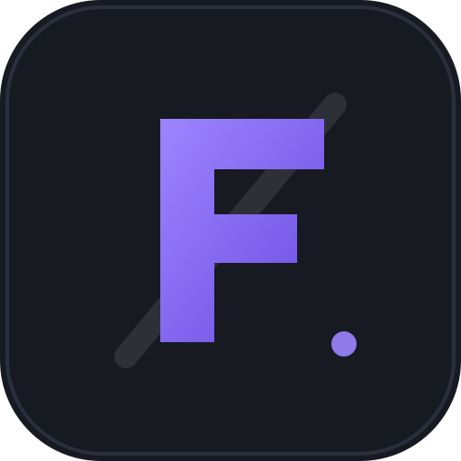
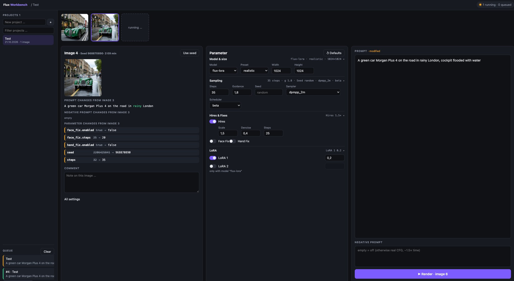

# flux-workbench

<p align="center"></p>

[](https://github.com/StefanOOEOrg/flux-workbench/actions/workflows/ci.yml)



Local workbench for FLUX renderings. Everything lives in plain folders on disk: create a project,
send render jobs through a queue to the render bridge, and compare each new image with the previous
one to see what changed in the prompt and in the parameters.

- `server/` – Python (FastAPI): files under `projects/`, render queue, bridge client, `open` viewer
- `web/` – Angular app (served by the server under `/`)
- `projects/YYYYMMDD-<name>/<n>.png` + `<n>.json` (`{"request": …, "effective": …, "render_seconds": …}`)

## What it does

- **Projects on disk.** One folder per project; one PNG plus one JSON file per image. No database —
  backing up or removing a project is moving or deleting its folder.
- **Render queue.** In-memory FIFO with one worker: `queued` → `running` → `done`/`error`,
  cancellable while queued, `Clear` removes the finished history. A restart empties the queue (by
  design); the images stay.
- **Parameter form.** Model & size, sampling, hires & fixes and a LoRA group built from
  `loras.json` (see below). `Defaults` restores the configured defaults; unsaved changes are
  guarded before they are thrown away.
- **Image column.** The selected image with seed and render time, the comparison to the previous
  image (next section), a free-text comment per image, `Use seed` to adopt a seed into the form,
  double-click to open the image in the system viewer, right-click to delete an image (no undo).
- **Queue panel.** Pending jobs of the project appear as placeholder tiles in the strip, the header
  shows running/queued counters, and the panel lists all queued/running/failed jobs plus the last
  five finished ones.

## How the image comparison works

Every render writes two files into the project folder: `<n>.png` and `<n>.json`. The JSON holds

```json
{
  "request":   { "prompt": "…", "steps": 35, "hires": { "scale": 1.5 } },
  "effective": { "prompt": "…", "steps": 40, "hires": { "scale": 1.5 } },
  "comment": "…",
  "render_seconds": 2.6
}
```

- `request` is what the workbench sent, `effective` what the bridge reports it actually used
  (`null` if the bridge does not report it), `render_seconds` the wall time of that render.
- The reference for the comparison is **the previous image in the strip**: the next lower number
  that exists in this project. Gaps are allowed — after deleting image 6, image 7 is compared with
  image 5. The first image has no predecessor.
- The column shows three separate diffs, all computed in the browser from those JSON files:
  - **Prompt** – word-level diff between predecessor and selected image (`added` / `removed`
    words, unchanged words stay neutral).
  - **Negative prompt** – the same for the `negative` key.
  - **Parameters** – one chip per changed path (`face_fix.steps  25 → 20`), found by walking both
    settings objects recursively and sorted by path. `prompt` and `negative` are left out here
    because they have their own two views.
- Values come from `effective` when present, otherwise from `request`, so the comparison shows what
  the renderer really did rather than only what was asked for.
- Without a predecessor the column says `First image` and shows no change list; identical settings
  show `No changes from the previous image`.

Because the comparison is derived from the files, it survives restarts and needs no server state:
the workbench only stores what was rendered. Old hand-written `<n>.json` files without `request` /
`effective` keys are treated as a plain request, so existing projects keep working.

## Requirements

- [uv](https://docs.astral.sh/uv/) (brings its own Python)
- Node.js ≥ 22 + npm

## Quick start

```bash
cp .env.example .env          # set FLUX_BRIDGE_URL for the GX10 (see below)
cd web && npm ci && npm run build && cd ..
uv run flux-workbench
```

Open <http://127.0.0.1:8080>. The start line prints the bridge URL and the env file in use.

## Configuration (environment variables)

Variables can be set in the shell or in a `.env` file in the repo root (gitignored). Copy the
template once and adjust it:

```bash
cp .env.example .env
```

The file is read **once at startup**, before the defaults below are applied. Precedence:
process environment > `.env` > default. `FLUX_ENV_FILE=/path/to/file` points the app at another
file. Rules: `KEY=VALUE` lines, `#` comments, optional `export `, values may be quoted.

| Variable | Default |
|---|---|
| `FLUX_BRIDGE_URL` | `http://127.0.0.1:8002/generate` |
| `FLUX_BRIDGE_TIMEOUT` | `900` (seconds) |
| `FLUX_PROJECTS_DIR` | `./projects` |
| `FLUX_LORA_CONFIG` | `./loras.json` |
| `FLUX_PORT` | `8080` |
| `FLUX_HOST` | `127.0.0.1` |
| `FLUX_ENV_FILE` | `./.env` |

> The bridge default `http://127.0.0.1:8002/generate` only fits a bridge running on the same
> machine. For a render host (e.g. a GX10 box) put
> `FLUX_BRIDGE_URL=http://YOUR-BRIDGE-HOST:8002/generate` into `.env`.
> The app prints the bridge and the env file it uses on startup, and a render error names the
> URL that failed.

## LoRA slots

The parameter form shows one control per LoRA slot listed in `loras.json` (at most 5 entries).
Which LoRA file a slot loads is decided by the render bridge on the GX10, so the `key` must be a
request key the bridge knows (today `lora_strength` and `lora2`).

```bash
cp loras.example.json loras.json   # then edit labels, defaults and toggles
```

`loras.json` is **not** committed (see `.gitignore`) — every machine keeps its own. Without the
file the form shows "No LoRAs configured"; a broken file falls back to the two built-in slots and
shows a warning.

## Development

```bash
uv run pytest && uv run ruff check server && uv run ruff format --check server
cd web && node node_modules/@angular/cli/bin/ng.js test --watch=false
# gates: node node_modules/eslint/bin/eslint.js src
#        node node_modules/prettier/bin/prettier.cjs --check "src/**/*.{ts,html,css}"
#        node node_modules/typescript/bin/tsc -p tsconfig.app.json --noEmit
#        node node_modules/typescript/bin/tsc -p tsconfig.spec.json --noEmit
# UI with live reload: start the server, then in web/: node node_modules/@angular/cli/bin/ng.js serve
```

**If `ng: not found` after `npm ci`:** your shell exports `NODE_ENV=production`, which makes npm skip
devDependencies. Use `env -u NODE_ENV npm ci` or `npm ci --include=dev`. CI does not set it, so a green
run there does not prove your shell is clean.

The server serves the built app from `web/dist/web/browser`; `ng serve` uses `proxy.conf.json` to
reach `/api` on port 8080 while developing.

## Repository layout

```
server/flux_workbench/   FastAPI app, project store, render queue, bridge client, .env loader
server/tests/            pytest suite (fake renderer, tmp dirs)
web/src/app/             Angular components, stores and services; specs next to them
docs/                    screenshot and the original UI mockup
loras.example.json       template for the per-machine LoRA slots
```

## License

MIT - see [LICENSE](LICENSE). Copyright (c) 2026 StefanOOEOrg.

## Scope and limitations

- Single user, local tool: the server binds `127.0.0.1` by default, there is no authentication and
  no multi-user support. Do not expose it to a network without putting a proxy with auth in front.
- A render bridge is required for rendering; browsing, comparing and deleting images works without.
- "Open image" uses the system viewer: `open` on macOS, `xdg-open` on Linux, `os.startfile` on
  Windows (needs `xdg-utils` on Linux).
- The web UI is a static build served by the same process; the API alone is enough for scripting.
